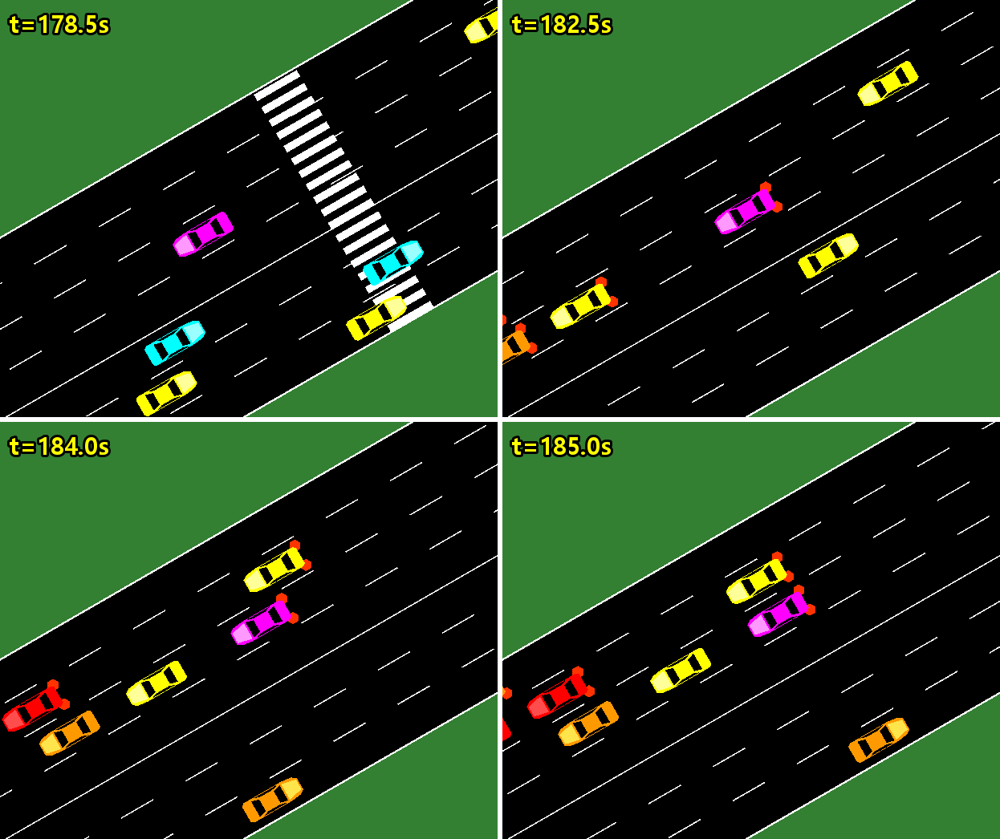
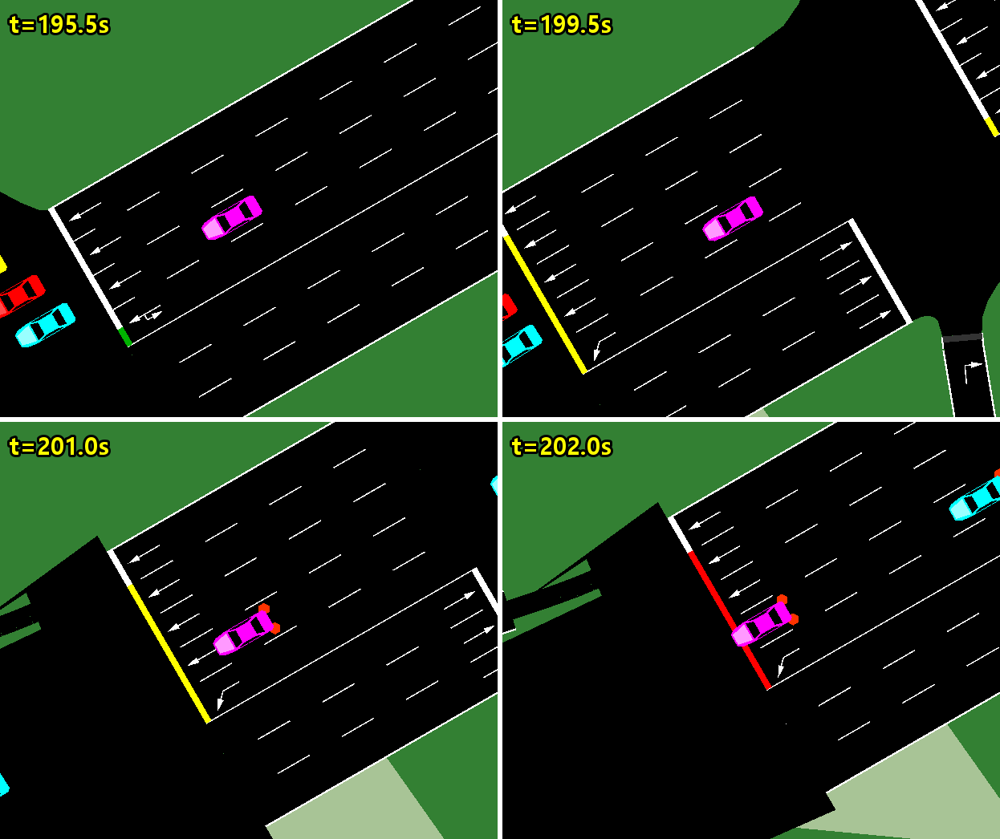
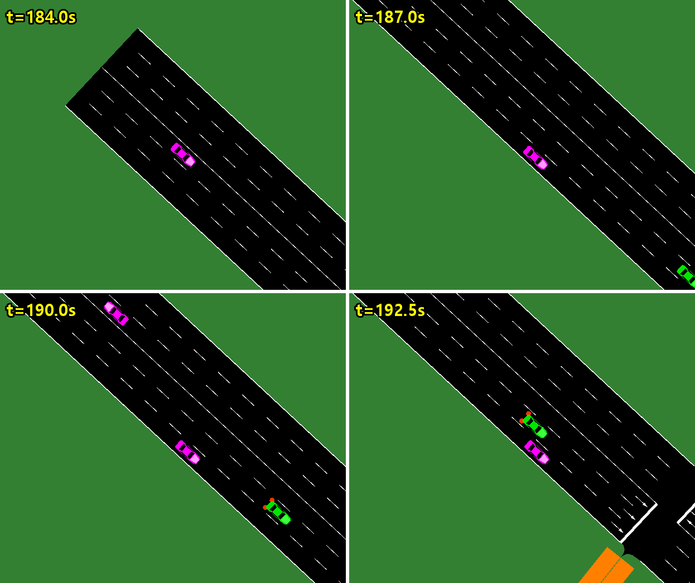
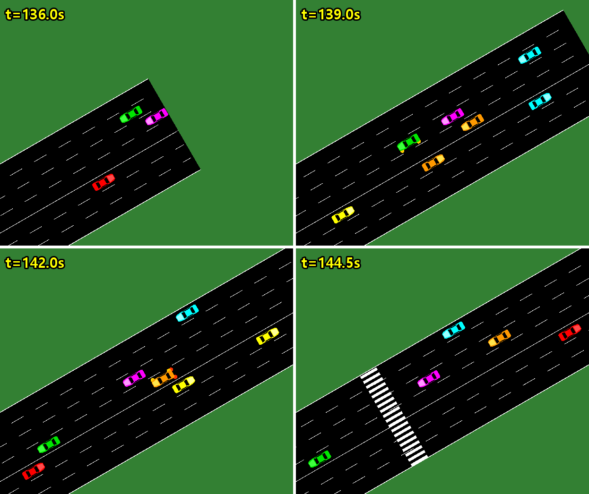

# BC 모델 주행 검토: 어디서 왜 실패하는가

`bc-traffic-calibration` 브랜치의 11월 21일 12:27 커밋(`cc323d0`)에 있는 BC 모델 2개를 검토했다.
혼합 교통 평가(`scripts/evaluate_mixed_traffic.py`)와 같은 교통·seed·판정 규칙으로 다시 돌리면서, 모든 차량의 주행을 스텝별로 기록했다(`scripts/review_mixed_traffic.py`). 대표 장면은 SUMO GUI로 재생해 캡처로 확인했다.

## 요약

| | 4,740 학습 모델 | 4,000 학습 모델 |
|---|---:|---:|
| BC 주행 수 (seed 12개 × 3,600초) | 10,994 | 9,334 |
| 완주 | 94.14% | 95.99% |
| 충돌 | **4.66%** (512) | 2.89% (270) |
| 신호 위반 | 0.82% (90) | 0.25% (23) |
| 차선 실패 | 0.38% (42) | 0.73% (68) |
| 시간 초과 | 0 | 0.14% (13) |

1. **충돌의 약 70%는 BC가 차선을 바꾸다 옆 차와 부딪힌 것이다.** 옆 차선 뒤에서 더 빠르게 오는 차 앞으로 끼어든다.
2. **충돌의 약 17%는 대기 줄에서 앞차에 닿는 것이다.** 갈림점 앞에서 앞차 간격 관측이 2.5m로 고정되는 오류 때문이다.
3. **신호 위반의 91%는 노란불 때 늦게 감속해서 빨간불에 정지선을 넘은 것이다.**
4. **4,740 모델의 충돌률은 과제 기준(5% 미만)에 안정적으로 들지 않는다.** seed 12개 중 3개에서 5%를 넘었다.
5. **재학습 없이 두 가지를 고치면 충돌률이 4.66%에서 2.5~3.0%로 줄고 완주율이 94.1%에서 95.3~95.6%로 오른다** (관측 오류 수정 + 차선 변경 판단 보정).
6. 충돌이 아닌 주행 자체는 SUMO 운전 모델보다 부드럽다. 급브레이크가 훨씬 적다. 다만 초록불 출발이 조금 굼뜨다.

수치는 제혁님 결과(4,740: 94.06% / 4.79%, 4,000: 96.06% / 2.86%)와 거의 같다. 평가 묶음을 이 PC에서 다시 만들어서 소수점 차이가 있다. 같은 seed 2개로 직접 비교하면 두 스크립트의 결과는 정확히 일치했다.

## 충돌률 5% 기준에 대한 여유

| | 충돌률 | 95% 신뢰구간 | seed별 범위 | 5%를 넘은 seed |
|---|---:|---:|---:|---:|
| 4,740 모델 | 4.66% | 4.27 ~ 5.05% | 3.82 ~ 6.06% | 12개 중 3개 |
| 4,000 모델 | 2.89% | 2.55 ~ 3.23% | 1.93 ~ 4.02% | 0개 |

4,740 모델은 seed에 따라 기준을 넘는다. 기준을 확실히 만족하는 것은 4,000 모델이다.

**BC 차량끼리의 충돌이 38%를 차지한다.** 이 평가는 차량의 20%가 BC 모델이라 BC끼리 만나는 일이 많다. BC 두 대가 부딪히면 두 주행이 모두 충돌로 집계된다.

| | 전체 충돌 | 상대가 BC | 상대가 배경차 | 배경차 충돌만 본 비율 |
|---|---:|---:|---:|---:|
| 4,740 모델 | 512 | 194 (97건의 사고) | 318 | 2.89% |
| 4,000 모델 | 270 | 100 (50건의 사고) | 170 | 1.82% |

자율주행 차 한 대가 일반 차량 사이를 달리는 상황이라면 충돌률은 이보다 낮을 것이다. 발표할 때 "차량의 20%가 우리 모델인 조건"이라는 점을 함께 밝히는 편이 좋다.

## 실패 유형 (4,740 모델 기준)

### 1. 차선 변경 충돌 — 충돌 512건 중 358건 (70%)

| 세부 | 건수 |
|---|---:|
| BC가 주행 중 차선을 바꾸다 옆 차와 충돌 | 247 |
| BC가 정지 상태에서 차선을 바꾸다 충돌 | 47 |
| 다른 BC가 차선을 바꾸며 들어와 부딪힘 | 64 |

- BC가 차선을 바꾸다 낸 충돌 294건 중 **94%에서 상대 차가 BC보다 빨랐다** (BC 중앙값 3.7 m/s, 상대 9.1 m/s). BC가 속도를 줄인 상태에서, 옆 차선 뒤쪽에서 오는 차 바로 앞이나 옆으로 들어간다.
- 절반(151건)은 앞에 빨간불이 있을 때다. 신호 대기 줄에 접근하면서 차선을 고르는 상황이다.
- 많이 나는 곳: 1100로 진입로 `A3_in1`(79건), 노형로 진입로 `A1_in2`(70건), 노연로 `A5_in1`(27건), 월랑로 `A4_in2`(24건). 모두 교차로 앞에서 경로에 맞는 차선으로 옮겨야 하는 긴 진입 구간이다.
- 평가에서는 차선 변경 안전 검사를 끄고(`lc_safety_enabled = False`) BC의 명령을 그대로 실행한다. 전문가(IDM)는 SUMO가 간격을 확인한 뒤에만 차선을 바꾸므로, 전문가 데이터에는 "바꾸려 했지만 간격이 없어 기다린" 순간이 행동으로 남지 않는다.



*seed 21701, 185.5초, 도령로 쪽 진입로(`A2_in1`). 분홍색이 BC 차량. 앞차 때문에 속도를 줄이다가(184.0초) 오른쪽 차선으로 바꾸는데, 그 차선의 노란 차와 겹친다.*

### 2. 대기 줄에서 앞차에 닿음 — 약 88건 (17%)

- 차선 변경 명령 없이 1 m/s 미만에서 난 충돌이 88건이다. 대부분 SUMO가 "교차점 충돌"로 분류한 100건에 들어 있다.
- BC가 0.05~0.3 m/s로 앞차 쪽으로 계속 다가가 겹친다. 원인은 모델이 아니라 **앞차 간격 관측이 2.5m에서 멈추는 오류**다(아래 "재학습 없이 시험한 수정" A).
- 76건이 월랑로 진입로의 샛길 갈림점(`nM_A4`) 앞, 24건이 노형로의 갈림점(`nM_A1`) 앞이다. 앞차가 갈림점의 짧은 연결 구간 위에 서 있을 때 난다.
- 월랑로→1100로(A4→A3) 경로의 충돌률이 13.5%로 가장 높은 이유가 이것이다.


*seed 21701, 486초, 월랑로 진입로의 샛길 갈림점. 분홍색 테두리가 BC 차량. 줄 맨 앞쪽에서 앞차와 겹친 채 서 있다가(483.0초), 앞차가 출발하는 순간 충돌로 판정된다.*

### 3. 노란불에 늦게 서서 신호 위반 — 90건 중 82건

- 위반 2초 전 신호가 노란불이었던 경우가 82건, 이미 빨간불이었던 경우가 8건이다.
- 위반 순간 속도 중앙값은 5.1 m/s, 직전 5초의 가감속 명령 평균은 -0.25다. 감속은 하지만 약해서 정지선을 넘는다.
- 1100로 진입로(31건), 노형로(19건), 월랑로(18건) 순이다.



*seed 21701, 202.5초, 도령로 쪽 진입로. 199.5초에 노란불로 바뀌고 BC는 감속하지만(201.0초, 브레이크등), 빨간불로 바뀐 202.0초에 정지선 위에 걸친다.*

### 4. 그 밖의 실패

- **추돌 25건** (BC가 뒤 17, BC가 앞 8).
- **차선 실패 42건**: 월랑로 `A4_in1`의 0번 차선(샛길 전용)에서 못 빠져나온 경우가 13건, 노형로 A1→A5가 8건.
- **4,000 모델의 시간 초과 13건**: 12건이 도령로→월랑로 샛길(`RING_A2_A4`) 위에서 멈춘 것이다. 4,740 모델에는 없다.

## 다른 차와의 상호작용 (성공 사례)

같은 평가(4,740 모델, seed 12개)에서 모든 차량의 추월과 끼어들기 대응을 같은 기준으로 셌다.

- **추월:** 앞차(40m 이내)가 자기보다 느릴 때 차선을 바꾸고, 30초 안에 같은 도로에서 그 차보다 앞서면 성공.
- **끼어들기 대응:** 다른 차가 바로 앞(15m 이내)으로 차선을 바꿔 들어왔을 때(자기 속도 3 m/s 이상), 이후 10초를 본다.

### 추월

| | 시도 (100회 주행당) | 성공 | 성공 (100회 주행당) | 추월 중 충돌 |
|---|---:|---:|---:|---:|
| **BC** | 29.4 | 1,876 | **17.1** | 15 |
| IDM (전문가) | 26.3 | 2,331 | 17.0 | 2 |
| Krauss | 4.1 | 495 | 3.0 | 7 |
| EIDM | 2.9 | 173 | 2.1 | 3 |
| ACC | 1.9 | 75 | 1.4 | 0 |

BC는 전문가(IDM, 속도 이득 차선 변경 켬)와 같은 빈도로 느린 차를 추월한다. 추월 성공 1,876건이다. 다른 운전 모델은 속도 이득 차선 변경을 꺼 둬서 추월이 드물다.



*seed 21701, 186.5~193초, 월랑로 진입로. 분홍색이 BC 차량(11.6 m/s), 초록색이 앞서 가던 느린 ACC 차량(4.8 m/s). 차선을 바꿔 나란히 지나간 뒤(192.5초) 앞선다.*

### 끼어든 차에 대한 대응

| 뒤차 | 사건 (100회 주행당) | 무사히 대응 | 충돌 | 충돌 비율 | 속도 감소 중앙값 | 최소 간격 중앙값 |
|---|---:|---:|---:|---:|---:|---:|
| **BC** | 6.7 | 722 | 19 | **2.6%** | 0.41 m/s | 5.7 m |
| IDM | 7.1 | 969 | 5 | 0.5% | 0.20 m/s | 7.1 m |
| Krauss | 7.8 | 1,267 | 2 | 0.2% | 1.23 m/s | 5.2 m |
| EIDM | 7.7 | 630 | 3 | 0.5% | 0.90 m/s | 5.2 m |
| ACC | 5.9 | 320 | 2 | 0.6% | 2.88 m/s | 8.1 m |

최소 간격은 SUMO가 알려 주는 값(minGap 제외)이다.

BC는 앞에 끼어든 차의 97%에 감속하며 간격을 유지했다. 다만 충돌 비율이 IDM의 약 5배다. BC가 끼어드는 쪽일 때 뒤차가 충돌한 비율은 1.0%로, 배경차가 끼어들 때(0.1~1.2%)와 비슷하다.



*seed 21701, 136~144.5초, 노형로 진입로. 분홍색이 BC 차량, 초록색이 왼쪽 차선에서 BC 앞으로 들어온 Krauss 차량. 139초에 3.4m 앞으로 들어오자 BC가 살짝 감속해 간격을 유지하고, 초록 차가 멀어진다.*

## 충돌이 아닌 주행 품질

완주한 주행만 놓고, 같은 교통 안의 SUMO 운전 모델과 같은 기준으로 비교했다 (4,740 모델, 주행 100회당).

| 지표 | BC | IDM | Krauss | EIDM | ACC |
|---|---:|---:|---:|---:|---:|
| 급브레이크 (4 m/s² 이상) 횟수 | **0.4** | 5.6 | 63.2 | 11.2 | 118.9 |
| 가속↔감속 전환 횟수 | **119** | 230 | 308 | 164 | 318 |
| 차선 변경 횟수 | 144 | 142 | 100 | 99 | 100 |
| 6초 안에 원래 차선으로 되돌아옴 | 1.2 | 0.6 | 0.1 | 0.1 | 0.2 |
| 초록불·앞이 빈 상태로 서 있던 주행의 비율 | **13.1%** | 4.0% | 3.3% | 14.7% | 4.6% |
| 5 m/s 넘게 달리며 앞차와 2m 이내였던 주행의 비율 | 4.1% | 1.0% | 4.3% | 1.5% | 1.1% |
| 평균 속도 (m/s) | 6.8 | 6.6 | 6.3 | 6.3 | 6.3 |

- **다른 차와 상호작용한다.** 앞차에 맞춰 감속하고 줄을 서며, 급브레이크는 SUMO 운전 모델 어느 것보다 적다. 가감속도 가장 매끄럽다.
- **어색한 점 1: 초록불 출발.** 초록불이고 앞이 비었는데 잠깐 서 있는 주행이 IDM의 3배다. 서 있는 시간 자체는 주행당 평균 0.07초로 짧다. 출발이 한 박자 늦는 정도다.
- **어색한 점 2: 차선 왔다 갔다.** 바꿨던 차선으로 금방 되돌아오는 경우가 IDM의 2배지만, 전체 주행의 1% 미만이다.
- **어색한 점 3: 앞차에 바짝 붙음.** IDM의 4배이고 Krauss와 비슷한 수준이다.

## 재학습 없이 시험한 수정 두 가지

충돌 직전에 모델이 실제로 받은 입력값을 기록해 보니, 두 유형의 원인이 달랐다.

### A. 앞차 간격 관측 오류 (대기 줄 충돌의 원인)

앞차가 갈림점의 연결 구간(다음 내부 차선) 위에 있을 때, SUMO의 `getLeader`는 간격을 0 아래로 내리지 않는다. 범퍼 간격 관측은 이 값에 minGap(2.5m)을 더해 만들므로, 차가 겹쳐 있어도 **2.5m로 고정**된다.

| 충돌 전 시각 | 모델이 본 앞차 간격 | 차선 위치로 계산한 실제 범퍼 간격 |
|---|---:|---:|
| 8초 전 | 2.50m | -3.70m |
| 1초 전 | 2.50m | -3.69m |

SUMO 간격이 0.3m보다 클 때는 관측과 실제가 일치한다(차이 중앙값 0.00m, 817표본). 0에 걸렸을 때만 관측이 실제보다 최대 6m 크다. 그래서 일반 정지선 앞의 줄에서는 잘 서고, 갈림점(`nM_A4`, `nM_A1`) 앞에서만 충돌이 났다.

수정: SUMO 값이 0에 걸리면 차선 위치와 길이로 범퍼 간격을 직접 계산한다 (`OBSERVATION["leader_gap_geometry"]`, 기본값은 꺼짐).

### B. 차선 변경 판단 기준의 치우침 (차선 변경 충돌의 원인)

차선 변경을 명령한 순간의 관측에는 옮겨 갈 차선의 차가 **간격 0m(바로 옆)**로 들어와 있었다(39건 중 37건). 모델은 그 차를 보고도 바꿨다.

학습할 때 차선 변경 클래스에 빈도 역수의 제곱근 가중치를 줬다(`lane_weights`: 왼쪽 1.42, 유지 0.086, 오른쪽 1.50). 변경이 유지보다 약 17배 무겁다. 이렇게 학습한 분류기는 전문가가 약 6%의 확률로만 바꿀 상황에서도 "변경"을 고른다.

수정: 추론할 때 차선 출력 점수에서 `log(가중치) × 세기`를 뺀다. 세기 1.0이면 가중치 효과를 전부 되돌린다. 간격 규칙을 넣는 것이 아니라, 가중치로 옮겨진 판단 경계를 되돌리는 보정이다.

### 결과 (4,740 모델, seed 12개, 재학습 없음)

| 설정 | 완주 | 충돌 | 차선 실패 | 신호 위반 | 충돌 5% 넘은 seed |
|---|---:|---:|---:|---:|---:|
| 지금 그대로 | 94.14% | 4.66% | 0.38% | 0.82% | 3/12 |
| A | 94.78% | 4.00% | 0.39% | 0.83% | 2/12 |
| A + B 세기 0.25 | **95.61%** | 3.00% | 0.54% | 0.79% | 0/12 |
| A + B 세기 0.5 | 95.17% | 3.25% | 0.70% | 0.81% | 1/12 |
| A + B 세기 0.75 | 95.27% | 2.48% | 1.42% | 0.75% | 0/12 |
| A + B 세기 1.0 | 93.98% | **2.32%** | 2.76% | 0.80% | 0/12 |

| 설정 | 옆 충돌 | 갈림점 앞 충돌 | 추돌 |
|---|---:|---:|---:|
| 지금 그대로 | 387 | 100 | 25 |
| A | 426 | 2 | 11 |
| A + B 세기 0.75 | 249 | 2 | 20 |
| A + B 세기 1.0 | 233 | 0 | 20 |

- **A는 부작용이 없다.** 갈림점 앞 충돌이 100건에서 2건이 됐다.
- **B는 세기에 따라 충돌과 차선 실패가 맞바뀐다.** 세게 걸수록 옆 충돌은 줄지만 필요한 차선 변경까지 줄어 차선 실패가 는다. 세기 0.25~0.75에서 완주율이 가장 높다(95.2~95.6%). 0.25와 0.5의 순서가 뒤집힌 것처럼, 이 범위 안의 차이는 seed에 따른 흔들림 수준이다.
- A + B(0.75)는 충돌률이 4.66%에서 2.48%로 줄고, 12개 seed 모두 5% 미만이다.
- 신호 위반은 두 수정 모두 영향이 없다.

## 다음 학습을 위한 제안

교수님 방침대로 규칙을 덧씌우지 않고 학습으로 푸는 방향만 적었다.

| 실패 유형 | 제안 |
|---|---|
| 관측 | `leader_gap_geometry`를 켠 상태로 데이터를 수집하고 평가한다. 전문가(IDM)는 minGap보다 가까이 붙지 않아 기존 데이터의 값은 거의 달라지지 않지만, DAgger에서는 BC가 만든 근접 상태가 올바른 간격으로 기록된다 |
| 차선 변경 가중치 | 다시 학습한다면 차선 클래스 가중치를 낮춘다(예: 제곱근 대신 네제곱근). 추론 보정 세기 0.25~0.75가 좋았으므로 지금 가중치는 과하다 |
| 차선 변경 충돌 (70%) | DAgger 수집에서 "BC가 차선을 바꾸려 한 스텝"을 우선 모은다. 그 상태에서 IDM의 답은 대부분 "유지"라서, 지금 데이터에 부족한 "간격이 없으면 기다린다"는 예시가 된다. 진입로 `A3_in1`, `A1_in2`의 표본을 늘리는 것도 방법이다 |
| 노란불 위반 | 노란불 상태의 표본을 따로 세어 보고, 적으면 가중치를 높이거나 DAgger에서 우선 수집한다 |
| 평가 조건 | 최종 보고 수치는 4,000 모델로 하거나, 4,740 모델이면 seed를 더 늘려 충돌률을 다시 확인한다 |

## 재현 방법

```bash
# 평가 묶음 (보정 도로, 4,740대/시간). 제혁님 묶음처럼 IDM만 lcSpeedGain=1.0, 나머지 0으로 바꿔서 사용했다.
python scripts/evaluate_fixed_routes.py prepare analysis/bc_suite_4740 \
    --reference results/eval_fixed_routes_20261119_214714/reference --current-road --traffic-vph 4740

# 전체 기록 (seed 12개, 약 10분): trips.csv, events.json
python scripts/review_mixed_traffic.py analysis/bc_suite_4740 \
    --model results/BC_20261121_020515_calibrated_4740/training/model.pt --output analysis/bc_review_4740

# 수정 시험: A(관측) + B(차선 판단 보정 세기 0.75)
python scripts/review_mixed_traffic.py analysis/bc_suite_4740     --model results/BC_20261121_020515_calibrated_4740/training/model.pt --output analysis/bc_fix     --leader-gap-geometry --lane-prior 0.75

# 특정 장면을 SUMO GUI로 재생하며 캡처 (차량:시각:이름). 해당 seed를 처음부터 돌리므로 시각이 늦을수록 오래 걸린다.
python scripts/review_mixed_traffic.py analysis/bc_suite_4740 \
    --model results/BC_20261121_020515_calibrated_4740/training/model.pt --output analysis/bc_shots \
    --seeds 21701 --capture bg_218:185.5:lane_change bg_577:486.0:queue_creep bg_234:202.5:yellow
```

`events.json`에는 실패한 BC 주행마다 마지막 20초의 스텝별 상태(위치, 속도, 가감속·차선 명령, 앞차 간격, 신호)와 충돌 상대가 들어 있다.

## 한계

- A와 B는 4,740 모델에서만, 재학습 없이 추론 단계에서 시험했다. 4,000 모델과 재학습 후의 효과는 확인하지 않았다.
- 노란불 신호 위반과 "다음 학습을 위한 제안"의 학습 방법들은 시험하지 않았다.
- A를 켰을 때 옆 충돌이 387건에서 426건으로 늘었다. 줄에서 끝났을 주행이 더 이어지며 생긴 것으로 추정하지만 확인하지 않았다.
- 장면 캡처는 seed 21701의 앞 500초에서 5개만 확인했다. 나머지는 수치로만 분류했다.
- "어색함"은 수치 기준으로 판정했다. 사람이 GUI로 보고 느끼는 자연스러움과 다를 수 있다.
- 평가 묶음을 다시 만든 것이라 제혁님 묶음과 완전히 같지는 않다.
