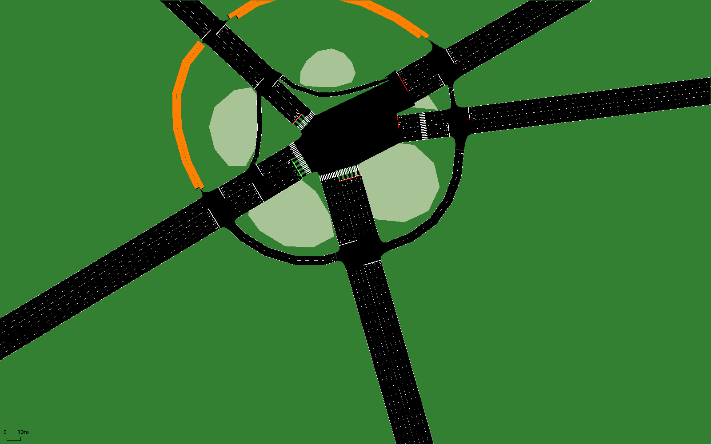
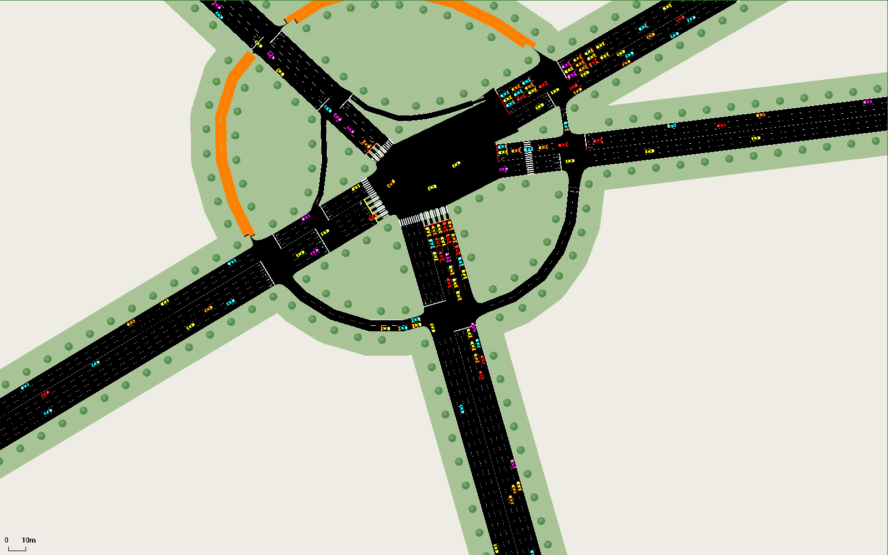
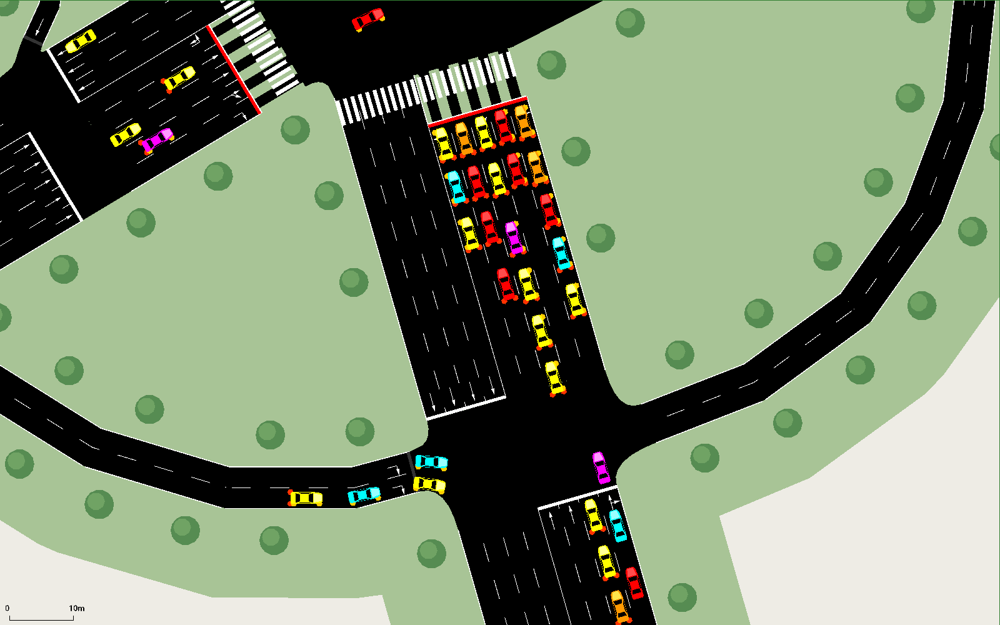

# 발표용 도로 꾸미기 (sumo-gui)

sumo-gui 화면을 지도처럼 정리한다. 배경은 단색, 도로 옆과 교차로 안쪽 빈 땅은 잔디, 길가에는 나무를 14 m 간격으로 둔다.

| 전 | 후 |
|---|---|
|  |  |



혼합 교통 재생 300초 시점이다. 빨간 차가 BC 차다.

## 동작 방식

- `scripts/make_road_decor.py`가 도로 파일(`highway.net.xml`)을 읽어 `highway.decor.xml`을 만든다. 이 파일은 다각형(poly)만 담은 SUMO additional 파일이다.
- 장식은 GUI로 볼 때만 불러온다. `scripts/play_mixed_traffic.py`와 `view_road.py`는 sumo-gui를 띄울 때 보여 주는 도로에 맞춰 장식 파일을 다시 만들고 함께 불러온다.
- 학습과 화면 없는 평가는 `highway.sumocfg`를 그대로 쓰므로 장식을 불러오지 않는다. 도로, 차선, 정지선, 시뮬레이션 결과는 바뀌지 않는다.

## 직접 열기

```bash
python scripts/make_road_decor.py env/sumo/highway.net.xml
sumo-gui -c env/sumo/highway.sumocfg -a env/sumo/highway.scenery.xml,env/sumo/highway.decor.xml
```

`-a`는 설정 파일의 additional 목록을 대신하므로 기존 `highway.scenery.xml`(횡단보도, 정지선)도 함께 적는다.

색, 잔디 폭, 나무 간격은 `scripts/make_road_decor.py` 맨 위 상수에서 바꾼다.
